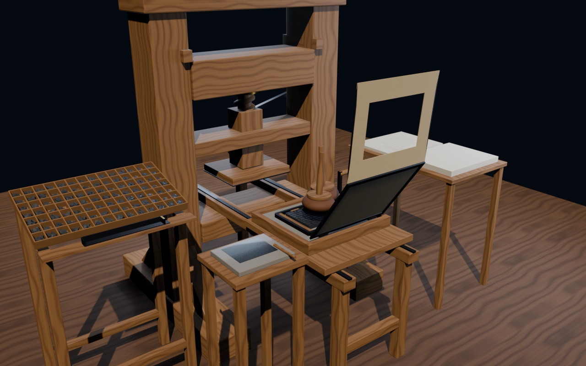

# Gutenberg druckt – die Druckerpresse in 3D

Interaktive 3D-Animation (Blender → Three.js) für den Geschichtsunterricht (Sek. I): Gutenbergs Werkstatt in Mainz um 1454. In zehn Arbeitsschritten von der beweglichen Letter über das Setzen, Einfärben und Drucken bis zum fertigen, von Hand rubrizierten Bogen. Mit klickbaren Bauteilen, Live-Werten (Bengel-Winkel, Presskraft, Karren), Phasen-Erklärungen und stufenlosem Zoom. Optimiert für Desktop, Tablet und Handy. LMG TECH.



## Online

https://simon23-12.github.io/BLENDERgpress/

Jeder Push auf `main` veröffentlicht den Ordner `web/` automatisch über GitHub Pages – ohne Build-Schritt, ohne npm.

## Lokal ansehen

```bash
node serve.mjs
```

Dann http://127.0.0.1:5173 öffnen (kein `npm install` nötig; Three.js kommt per Import-Map von jsDelivr).

## Bedienung

- **Bauteile** anklicken/antippen oder aus der Liste wählen → Infotext, Fakten und Live-Werte.
- **‹ ›** in der Phasenkarte bzw. Pfeiltasten ← → springen zwischen den 10 Arbeitsschritten, Leertaste = Pause.
- **Folgen** lässt die Kamera bei jedem Arbeitsschritt an die passende Stelle fliegen (Setzkasten, Druckform, Bogen …).

## Die Arbeitsschritte

1. Die bewegliche Letter (Kegel, spiegelverkehrtes Bild, Signatur)
2. Setzen – 41 Lettern fliegen aus dem Setzkasten in den Winkelhaken
3. Die Zeile wandert in die Druckform (Schließrahmen, Stege, Keile)
4. Einfärben mit zwei Druckerballen – die Lettern werden schwarz
5. Papier einlegen: Deckel, Punkturen, Rähmchen
6. Einfahren mit der Kurbel
7. Der Druck: Bengel ziehen, Spindel dreht, Tiegel presst
8. Ausfahren
9. Der fertige, seitenrichtige Bogen
10. Rubrikator malt die rote Initiale

## Aufbau

- `blender/build_gpress.py` – erzeugt Werkstatt, Presse, Lettern, Animation und Export prozedural (im offenen Blender ausführen). Schreibt `blender/gpress.blend`, `web/models/gpress.glb` (Meshopt-komprimiert) und `web/models/timeline.json`.
  - Holzmaserung wird im Skript mit NumPy erzeugt (keine heruntergeladenen Texturen).
  - Die Lettern sind echte 3D-Glyphen (gebrochene Schrift aus `STIXTwoMath.otf`, mitgeliefert mit macOS), spiegelverkehrt auf dem Kegel; Zeilen im Blocksatz wie in der B42, mit Platz für die Initiale.
  - Der Abzug (`web/models/bogen.jpg`, `bogen_rubr.jpg`) wird in Blender **gerendert**: eine orthografische Kamera fotografiert die eingefärbten Letternbilder, danach kommen Papierton, Farbquetschung und Fasern dazu. Die UV-Koordinaten des Bogens werden aus seiner Lage beim Druck berechnet – deshalb ist der Druck automatisch seitenrichtig.
  - Text: Genesis 1,1–7 nach der Vulgata (Schreibweise wie in der B42, z. B. „creauit“).
- `web/` – statische Seite (Three.js per Import-Map, kein Build). `src/core.js` ist der gemeinsame Viewer der LMG-TECH-Modelle, `src/main.js` die Presse, Texte in `src/content.js`.

Maßstab: 1 Einheit = 1 dm. Vereinfachungen: Lettern ≈ 3-fach vergrößert, Hub des Tiegels überzeichnet (≈ 1,7 cm statt ≈ 1 cm), Riemen der Kurbel weggelassen, ein Durchgang zeigt nur eine Druckform (Gutenberg druckte jede Seite in zwei Zügen bzw. mehrere Seiten pro Bogen).
